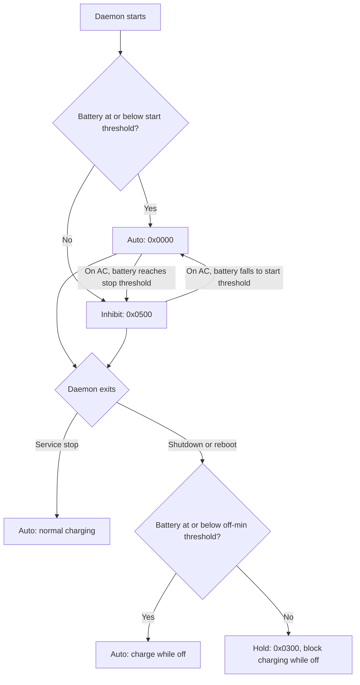

# hp-charge-limit-rs

Battery charge limiter using the firmware's ACPI WMI method
`\_SB.WMID.SBCC` through `acpi_call`.

I tried this on an HP Victus 16-r1000 laptop. It may work on your PC too,
but compatibility is not guaranteed: your firmware must expose the same
methods and buffer layout. There is no model or board check, so verify
compatibility before using it; unsupported firmware calls can be unsafe.

| mode | SBCC | while running | survives shutdown |
|---|---|---|---|
| `auto` | 0x0000 | charges | — |
| `inhibit` | 0x0500 (SBIS) | no charge, white LED, "Not charging" | no, EC clears it |
| `hold` | 0x0300 (SBTC) | no charge, LED/status still say charging | yes (live test 2, one 12.5 min trial) |

Only these three are ever written (never discharge 0x0200 or ship mode 0x0600/0x0700).

## Why this repo?

I know other repos already expose `0x0500` (inhibit), but none of the ones
I tried stopped my laptop from charging while it was off. They worked
while running, but after shutdown it kept charging.

This repo uses inhibit while running and, by default, switches to
`0x0300` (hold) at shutdown to keep charging blocked while off. It also
has a low-battery override so the laptop can charge while off when needed.
Hold survived a short shutdown trial on my laptop; behavior on other PCs
and over longer off periods is not yet verified.

## How it works

Default policy with bypass disabled (mode changes depend on successful firmware writes):



Charging resumes at the start threshold (default: 40%) and stops at the
stop threshold (default: 50%). At shutdown, the off-min threshold
(default: 40%) selects normal charging instead of hold when the battery
is low. All three thresholds are configurable.

Between thresholds, the current state is kept. Polls on battery leave the
firmware mode unchanged. Shutdown detection and off-state behavior have
the limitations described below.

## Install

Requires Linux, systemd for the service, and the `acpi_call` module built for
your running kernel. Install the module using your distribution's packages;
DKMS packages also need matching kernel headers. Firmware access requires
root. Some module packages, including Arch's `acpi_call`, already configure
loading at boot; no additional module-load file is needed in that case.

Power supplies are discovered under `/sys/class/power_supply` by type,
ignoring peripherals marked `scope=Device`. One present battery is
selected: `BAT1` if available, otherwise the first battery in alphabetical
name order. Multiple batteries are not aggregated. Any online system-level
mains, USB, or wireless supply counts as external power. Discovery is refreshed
on each read to handle hotplug. Discovery does not establish firmware compatibility.

### Linux (manual installation)

**Prebuilt binary:** once a release is published, download its `.tar.gz`
and matching `.tar.gz.sha256` from this repository's GitHub Releases page.
Choose `x86_64-unknown-linux-musl` for x86_64 PCs or
`aarch64-unknown-linux-musl` for ARM64 Linux. These are static binaries;
you still need the kernel module and compatible firmware.

For example, for an x86_64 release (set `name` to the archive you downloaded,
without `.tar.gz`):

```sh
name=hp-charge-limit-rs-vX.Y.Z-x86_64-unknown-linux-musl
sha256sum --check "$name.tar.gz.sha256"
tar -xzf "$name.tar.gz"
cd "$name"
binary=./hp-charge-limit-rs
```

**Or build from source:** from a checkout, with Rust 1.89 or newer:

```sh
cargo build --locked --release
binary=target/release/hp-charge-limit-rs
```

For either option, check the binary before installing:

```sh
sudo modprobe acpi_call
sudo "$binary" status
```

The binary does not install itself. From the extracted archive or source
checkout, install it, the systemd service, and the
[desktop notification](#desktop-notifications) bus policy and autostart entry:

```sh
sudo install -Dm755 "$binary" /usr/bin/hp-charge-limit-rs
sudo install -Dm644 packaging/hp-charge-limit-rs.service /etc/systemd/system/hp-charge-limit-rs.service
sudo install -Dm644 packaging/io.github.kralonur.HpChargeLimit.conf /usr/share/dbus-1/system.d/io.github.kralonur.HpChargeLimit.conf
sudo install -Dm644 packaging/io.github.kralonur.HpChargeLimit.Notify.desktop /etc/xdg/autostart/io.github.kralonur.HpChargeLimit.Notify.desktop
sudo install -Dm644 README.md /usr/share/doc/hp-charge-limit-rs/README.md
sudo install -Dm644 LICENSE-MIT /usr/share/licenses/hp-charge-limit-rs/LICENSE-MIT
sudo install -Dm644 LICENSE-APACHE /usr/share/licenses/hp-charge-limit-rs/LICENSE-APACHE
# First install only: do not overwrite an existing configuration.
sudo install -Dm644 packaging/hp-charge-limit-rs.conf /etc/hp-charge-limit-rs.conf
sudo systemctl daemon-reload
sudo systemctl enable --now hp-charge-limit-rs
```

Only if your module package does **not** already configure loading at boot:

```sh
printf 'acpi_call\n' | sudo tee /etc/modules-load.d/hp-charge-limit-rs.conf
```

On upgrades, replace the binary and unit but keep your existing config.
Settings: edit `/etc/hp-charge-limit-rs.conf`, then `sudo systemctl restart hp-charge-limit-rs`.
The service creates its state directory automatically.

To uninstall a manual installation:

```sh
sudo systemctl disable --now hp-charge-limit-rs
sudo rm /usr/bin/hp-charge-limit-rs /etc/systemd/system/hp-charge-limit-rs.service
sudo rm -f /usr/share/dbus-1/system.d/io.github.kralonur.HpChargeLimit.conf \
    /etc/xdg/autostart/io.github.kralonur.HpChargeLimit.Notify.desktop
sudo systemctl daemon-reload
# Only if you created this file during installation:
sudo rm -f /etc/modules-load.d/hp-charge-limit-rs.conf
```

Stopping the service restores normal charging with the default stop mode.
Your config, documentation, licenses, and off-state history remain in
`/etc/hp-charge-limit-rs.conf`, `/usr/share/doc/hp-charge-limit-rs/`,
`/usr/share/licenses/hp-charge-limit-rs/`, and `/var/lib/hp-charge-limit-rs/`;
remove them separately if no longer needed.

### Arch Linux (AUR)

Choose one of these instead of the manual installation. Both packages
depend on `acpi_call`; choose a module package appropriate for your kernel.

- [`hp-charge-limit-rs-bin`](https://aur.archlinux.org/packages/hp-charge-limit-rs-bin):
  prebuilt static binary from the GitHub Release, for x86_64 and ARM64. No Rust
  or compilation required.
- [`hp-charge-limit-rs`](https://aur.archlinux.org/packages/hp-charge-limit-rs):
  built from source with `cargo`, for x86_64.

Install either one with an AUR helper, for example:

```sh
paru -S hp-charge-limit-rs-bin
```

The two packages provide the same binary and conflict with each other;
install only one. After either installation:

```sh
sudo modprobe acpi_call
sudo systemctl enable --now hp-charge-limit-rs
```

Arch's `acpi_call` package already installs
`/usr/lib/modules-load.d/acpi_call.conf` to load the module at boot.
`modprobe` above loads it for the current session if needed; do not add a
duplicate config. If you use a different module package, check its setup.
The package installs the binary, unit, configuration, licenses, shell
completions, D-Bus policy, and notifier autostart entry;
`/etc/hp-charge-limit-rs.conf` is preserved on upgrades. Edit it and restart the
service to change settings.

To uninstall:

```sh
sudo systemctl disable --now hp-charge-limit-rs
sudo pacman -R hp-charge-limit-rs-bin   # prebuilt package
# Or: sudo pacman -R hp-charge-limit-rs # source-built package
```

## Use

```sh
sudo hp-charge-limit-rs status --watch 60   # energy over 60 s: charging or not
sudo hp-charge-limit-rs set hold            # one-off mode change
sudo hp-charge-limit-rs set auto            # restore normal charging
journalctl -u hp-charge-limit-rs -b         # daemon log for this boot
```

The running daemon can overwrite one-off mode changes on subsequent polls.
Stop the service first if you want manual control.

Status also shows battery manufacturer/model, health
(full capacity relative to design capacity), cycle count, and power in watts.
Missing readings are shown as `?`. Power uses `power_now`, or current × voltage
when available; health supports both energy- and charge-based sysfs values.
Power measures battery power flow, not total laptop consumption; zero is normal
when the adapter powers the laptop and the battery is neither charging nor
discharging. Cycle count is firmware-reported: a zero may mean an unused battery
or an unimplemented/inaccurate firmware reading. Health is a capacity estimate,
not an independent battery diagnostic.

### Setup diagnostics

```sh
sudo hp-charge-limit-rs diagnose
```

Checks battery discovery and capacity, external power supplies, the
`acpi_call` interface and access permissions, and firmware mode readback.
Reports service state and systemd unit/configuration paths; it does not
validate configuration values. An offline adapter is normal. Missing required
supplies, invalid readings, access failures, or failed firmware queries give a
nonzero exit status. An inactive/missing service or unavailable systemd is only
a warning, since manual commands do not require the service.

No charge modes are set, modules loaded, or services changed. Firmware readback
still issues a GBCC query through `/proc/acpi/call` (requiring write access),
not an SBCC mode-setting call. Running without sudo can report permission
failures. Successful diagnostics do not prove firmware compatibility or actual
charge blocking.

### Desktop notifications

The daemon runs as root, so it cannot show notifications itself. Instead it
broadcasts D-Bus signals on the **system bus**, and a small helper running as
your desktop user turns them into standard freedesktop notifications. KDE
Plasma, GNOME and other desktops with a notification server display them.

| signal | when | notification |
|---|---|---|
| `LimitReached(y capacity)` | charging blocked at the stop threshold | Charge limit reached |
| `ChargingResumed(y capacity)` | charging allowed again at the start threshold | Charging resumed |
| `BypassChanged(b enabled)` | bypass took effect or ended | Charge limit paused / resumed |
| `WriteFailed(s mode, s error)` | a firmware write failed (once per run of failures) | Charge control failed (critical) |

Like other desktop helpers for system services (KDE Discover's update
notifier, nm-applet, earlyoom's systembus-notify), the notifier is an XDG
autostart entry: it starts with every graphical login (KDE, GNOME, XFCE and
others), and never in SSH or TTY sessions. Both installation methods above
install the bus policy and the entry. When upgrading a running system,
restart the daemon once so it can claim its bus name, then log out and back
in (or run `hp-charge-limit-rs notify &` for now):

```sh
sudo systemctl restart hp-charge-limit-rs
```

The entry runs `hp-charge-limit-rs` from `PATH`. You can also just run
`hp-charge-limit-rs notify` in a terminal as your user, without root.

To turn notifications off:

- For yourself only, hide the autostart entry the standard way, which also
  survives package upgrades:

  ```sh
  mkdir -p ~/.config/autostart
  printf '[Desktop Entry]\nHidden=true\n' > ~/.config/autostart/io.github.kralonur.HpChargeLimit.Notify.desktop
  ```

- For everyone, stop the daemon sending signals: set
  `HP_CHARGE_LIMIT_RS_NOTIFY=false` in `/etc/hp-charge-limit-rs.conf` and
  restart the service. Running notifiers then stay idle.

Behavior and limits:

- Signals only, no D-Bus methods: nothing on the bus can change charging.
  Only root may own the bus name `io.github.kralonur.HpChargeLimit` (see the
  policy file), and the notifier accepts signals only from that name's
  current owner, including signals sent directly to it, so other users cannot
  fake notifications.
- Best effort. If the bus or the policy is missing, the daemon logs
  `D-Bus: signals disabled` once and keeps limiting normally. It retries at
  most once a minute, and only when it has an event to send. Events raised
  during an outage are dropped, not queued.
- Events come from the limiter's state changes, which only happen on AC power.
  Repeated failures while the firmware keeps refusing produce one
  notification, not one per poll. A new notification replaces the previous one
  instead of stacking.
- Starting, shutting down and stopping the service do not notify, except that
  a failed write at startup is reported. Every user running the notifier sees
  the notifications.
- Watch the raw signals with `busctl --system monitor io.github.kralonur.HpChargeLimit`.
- The D-Bus library accounts for most of the binary size (about 5 MB
  unstripped in a release build) and of the locked dependencies.

What was verified: against private system and session buses with the bus's
default policy, a fake notification server and the real daemon on fake sysfs/ACPI
files (event delivery, replacement, failure deduplication, no bus, name
denied, spoofed senders, malformed payloads, escaped markup, missing
notification server, bus loss, reconnection after the back-off, clean exit on
SIGTERM). The static x86_64 musl build was checked the same way. Not verified:
a real KDE or GNOME shell, the root-owned name on a real system bus (tests used
the current user in the policy instead of root), and the aarch64 build.

### Shell completion

Both AUR packages install completion files for Bash, Zsh, Fish, Elvish, and
PowerShell. Bash needs the `bash-completion` package installed and enabled for
automatic loading. Zsh needs completion enabled (`autoload -Uz compinit &&
compinit` if your shell setup does not already do it). Restart your shell after
installation. Elvish and PowerShell need the generated script loaded explicitly;
installing the file alone does not activate it.

For manual installations, generate scripts without root:

```sh
hp-charge-limit-rs completions bash > hp-charge-limit-rs.bash
hp-charge-limit-rs completions zsh > _hp-charge-limit-rs
hp-charge-limit-rs completions fish > hp-charge-limit-rs.fish
hp-charge-limit-rs completions elvish > hp-charge-limit-rs.elv
hp-charge-limit-rs completions powershell > hp-charge-limit-rs.ps1
```

Load the Bash script with `source hp-charge-limit-rs.bash`, or, with
`bash-completion` enabled, install it in
`/usr/share/bash-completion/completions/hp-charge-limit-rs`. For Zsh, install
`_hp-charge-limit-rs` in a directory on `$fpath`, such as
`/usr/share/zsh/site-functions/`. For Fish, place the script in
`~/.config/fish/completions/`. Elvish uses `eval (slurp < hp-charge-limit-rs.elv)`;
PowerShell uses `. ./hp-charge-limit-rs.ps1` (add it to your profile to persist).

### Temporary full-charge bypass

```sh
sudo hp-charge-limit-rs bypass on    # pause thresholds and allow normal charging
sudo hp-charge-limit-rs bypass off   # resume the configured charge band
```

The daemon must be running. Changes take effect on its next AC-powered poll;
`status` shows whether bypass is requested, not confirmation that firmware
accepted it.
While enabled, the daemon requests auto instead of enforcing thresholds,
including when it exits at shutdown or service stop. Turning bypass off
reapplies the startup policy on the next AC-powered poll: auto at or below
the start threshold, otherwise the configured run mode.

The flag lives at `/run/hp-charge-limit-rs.bypass`, so a service restart keeps
it but reboot clears it. Bypass allows a full charge while powered off too;
after boot, normal limiting resumes. While on AC, failed bypass/resume writes
are retried on subsequent polls. Shutdown and service-stop writes are attempted
once; failures are logged.

## Daemon options

Each is a `daemon` flag or the environment variable in brackets
(the conf file sets these; a flag wins over the variable).

- `--stop` / `--start` (`HP_CHARGE_LIMIT_RS_STOP` / `_START`): stop and resume thresholds
  while running (defaults: stop 50%, start 40%)
- `--run-mode inhibit` (`_RUN_MODE`): mode used at `--stop` (`hold` also works, orange LED)
- `--off-mode hold` (`_OFF_MODE`): mode set at shutdown/reboot (`inhibit`, `auto`, `keep`)
- `--off-min` (`_OFF_MIN`): at shutdown, at or below this threshold use auto
  to charge while off (default: 40%)
- `--stop-mode auto` (`_STOP_MODE`): mode set when only the service is stopped (`systemctl stop`);
  with auto a stopped service leaves the laptop stock, including while off
- `--interval 30` (`_INTERVAL`): poll interval in seconds (minimum 5)
- `--notify true` (`_NOTIFY`): broadcast D-Bus signals for desktop
  notifications; `false` keeps the daemon off the bus entirely

Percentages must be within 0–100, with `start < stop` and `stop >= 1`.
`--run-mode` accepts `auto`, `inhibit`, or `hold`; both exit modes also accept
`keep`. With `--off-mode keep`, the low-battery override does not change the
mode. The config file is read by the systemd service, not by direct CLI runs.

At start it requests auto at or below `start`, otherwise the run mode,
replacing a hold left from shutdown. While running, it stops charging at
`stop` and resumes at `start`; ticks on battery leave the mode alone.
Shutdown is told apart from a service stop by `systemctl is-system-running` = `stopping`.
At shutdown it saves energy_now; at the next start it logs
`off N min in hold: 51% -> 51%, energy +0 mWh` (journal, and in `status`).

## Publishing releases

The Linux release workflow uses current stable Rust and builds static
x86_64 and ARM64 binaries. Archives include the binary, README, licenses,
systemd unit, default config, D-Bus policy, and notifier autostart entry, with
a separate SHA256 checksum.

Set the version in `Cargo.toml`, update `Cargo.lock`, commit, then push a
matching version tag to GitHub:

```sh
version=$(cargo pkgid | cut -d'#' -f2)
git tag "v$version"
git push origin main
git push origin "v$version"
```

The AUR packages pick up new releases automatically.

The tag must match the package version. GitHub Actions publishes the
release and assets using its built-in token; no personal token is needed.
The workflow can also be run manually to build downloadable Actions
artifacts without publishing a release. An existing release must be
removed before rerunning its publishing job.

## Code layout

`main.rs` only parses the CLI and calls `hp_charge_limit_rs::run` (`lib.rs`).

| module | role |
|---|---|
| `cli` | clap definitions, defaults as named constants |
| `daemon/` | `mod.rs` loop: waits on a signal channel with the poll interval as timeout; `limiter` the charge band state machine and exit policy |
| `firmware` | SBCC command building, GBCC parsing, acpi_call transport (lock, single read), `ChargeControl` trait (implemented by `Wmi`) |
| `power` | sysfs battery/AC readings, `Energy`/`Voltage` unit types |
| `offstate` | energy record across shutdown |
| `bypass` | temporary bypass flag shared by the CLI and daemon |
| `diagnose` | setup checks, GBCC readback, service configuration reporting; no mode changes |
| `events` | D-Bus signal definitions and the daemon-side emitter (best effort) |
| `notify` | user-side helper turning those signals into desktop notifications |
| `status`, `systemd`, `paths` | status command, systemctl queries, system paths |

During normal polling, a failed threshold transition keeps the current state
and is retried on the next AC-powered poll if the threshold condition still
holds. If a startup write fails, initialization is retried on each AC-powered
poll, including between thresholds. Each retry uses the current capacity and
bypass request to select the mode. After a successful write, normal hysteresis
resumes. Successful writes mean the ACPI call returned without an
`acpi_call` error, not independent verification of charge flow. `finish`
consumes the limiter, so nothing ticks after it.

## Verification and limitations

There is currently no automated test suite. `cargo check --locked` checks
compilation; it does not verify firmware behavior.

Previous observations on my laptop reported inhibit readback as GBCC
mode 4 and hold surviving one approximately 12.5-minute shutdown trial.
These are limited observations, not a guarantee for other machines or
firmware versions.

Still unverified:

- Whether `systemctl is-system-running` reports `stopping` when this service
  exits during a real shutdown. Check the previous boot's journal for
  `shutdown: cap=..% -> hold`, and the next boot for the `off N min` report.
- Holding through AC unplug/replug while off or over long off periods.

The off-state record and last report live under `/var/lib/hp-charge-limit-rs/`.
In hold mode, LED and battery status may still say charging; use
`status --watch 60` to observe energy changes instead.

## License

This project's original code is dual-licensed under either
[MIT](LICENSE-MIT) or [Apache-2.0](LICENSE-APACHE), at your option
(`MIT OR Apache-2.0`).
