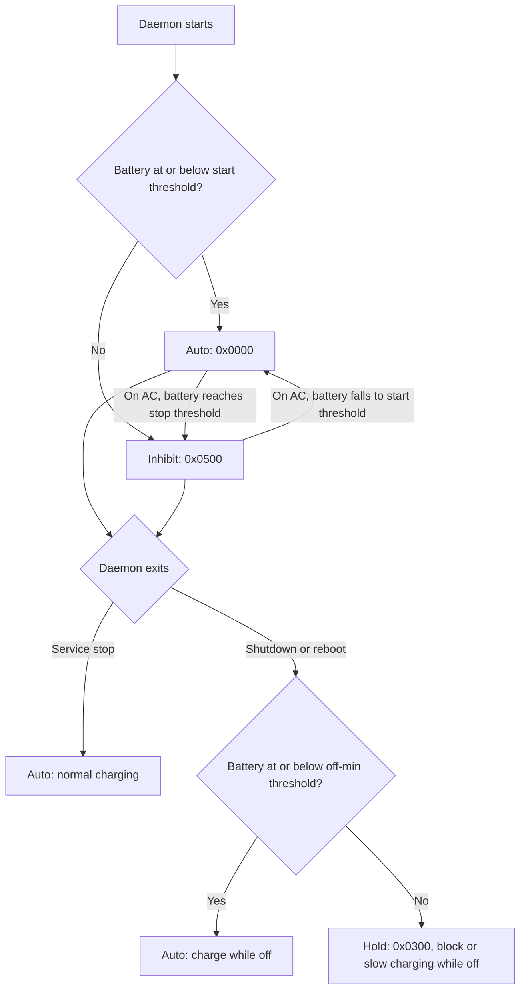

# hp-charge-limit-rs

Battery charge limiter using the firmware's ACPI WMI method
`\_SB.WMID.SBCC`: through `acpi_call` on Linux, and through HP's BIOS WMI
interface on Windows (see [Tested models](#tested-models)). Linux prefers
`GBCO`/`SBCO` when declared, otherwise using the `GBCC`/`SBCC` buffer
interface. Before any charge-control call, ACPICA's `iasl` inspects the
DSDT and SSDTs (including dynamically loaded tables) offline to discover
method signatures. Supported pairs are `GBCO(0)`/`SBCO(1)` (packed integer),
`GBCO(0)`/`SBCO(4)` (four byte arguments), and `GBCC(0)`/`SBCC(1)` (buffer).
Unknown, incomplete, or ambiguous signatures and tool failures are rejected;
there is no fallback to guessed writes. Argument counts do not prove that
unknown firmware implements the same semantics.

I tried this on an HP Victus 16-r1000 laptop. It may work on your PC too,
but compatibility is not guaranteed: your firmware must expose the same
methods and buffer layout. There is no model or board check, so verify
compatibility before using it; unsupported firmware calls can be unsafe
(see [Is it safe for my laptop?](#is-it-safe-for-my-laptop)).

| mode | SBCC | while running | survives shutdown |
|---|---|---|---|
| `auto` | 0x0000 | charges | — |
| `inhibit` | 0x0500 (SBIS) | no charge, white LED, "Not charging" | no, EC clears it |
| `hold` | 0x0300 (SBTC) | no charge or slow charge, depending on the board; LED/status still say charging | yes, but on some boards it only slows charging |

Only these three are ever written (never discharge 0x0200 or ship mode 0x0600/0x0700).
Inhibit (the limit while running) works on the confirmed models, but not
every reported board/OS combination; hold (the limit while off) also depends
on the board: see [Tested models](#tested-models).

## Contents

- [Is it safe for my laptop?](#is-it-safe-for-my-laptop)
- [Why this repo?](#why-this-repo)
- [Tested models](#tested-models)
- [How it works](#how-it-works)
- [Install](#install)
  - [Linux (manual installation)](#linux-manual-installation)
  - [Arch Linux (AUR)](#arch-linux-aur)
  - [Windows](#windows)
- [Use](#use)
  - [Setup diagnostics](#setup-diagnostics)
  - [Desktop notifications](#desktop-notifications)
  - [Shell completion](#shell-completion)
  - [Temporary full-charge bypass](#temporary-full-charge-bypass)
- [Daemon options](#daemon-options)
- [Publishing releases](#publishing-releases)
- [Code layout](#code-layout)
- [Verification and limitations](#verification-and-limitations)
- [License](#license)

## Is it safe for my laptop?

The worst this tool can do is stop your battery from charging. Use
`bypass on` to allow normal charging while the service is running, or
`set auto` if no daemon is running. It is still an unofficial tool,
provided without warranty (see the licenses). These are the reasons the
risk is small:

- **It only switches charging on and off.** The three modes are the
  firmware's own charge switches: four flags in the embedded controller's
  (EC) memory, WACL, SBIS, SBTC and WPBS. `auto` clears all four, which is
  the stock state. Nothing touches BIOS settings, NVRAM or flash, and on
  Windows no driver is installed.
- **It never charges more, and never drains or disconnects the battery.**
  A limiter only ever charges less. The battery pack's own protection
  electronics are not touched; inhibit and hold are states the EC firmware
  itself implements. Force-discharge (0x0200) and battery ship mode
  (0x0600/0x0700, which disconnects the battery) cannot be expressed in the
  code: no command or option sends them.
- **Firmware without this method refuses the call.** `diagnose` only reads.
  On Linux, `acpi_call` answers `AE_NOT_FOUND` when the method is missing;
  on Windows, HP's BIOS answers return code 4 for a command type it does not
  have. Nothing changes in either case. The remaining risk is firmware that
  has the method but means something else by it. That is why you should run
  [`diagnose`](#setup-diagnostics) first (on Windows, follow the
  [test order](#windows)), and why reports with
  your model matter.
- **Undo is one command, and stopping does it for you.** With the service
  running, [`bypass on`](#temporary-full-charge-bypass) pauses its limits and
  allows normal charging on the next AC-powered poll. `set auto` is only a
  one-time firmware change: a running daemon can override it. Stopping or
  uninstalling the service sets auto by default. Inhibit ends by itself at
  shutdown. Hold is the only mode
  that outlasts a shutdown, until `set auto` or the service's next start.
  In hold the LED and battery status may say charging; that is only
  cosmetic. On some boards hold still lets a slow charge through (about
  2 W), so it limits less, but it never charges faster than normal.

Uninstalling leaves the laptop as it was before: see the uninstall steps
for [Linux](#linux-manual-installation), [Arch](#arch-linux-aur) and
[Windows](#windows) (*Remove everything*).

## Why this repo?

I know other repos already expose `0x0500` (inhibit), but none of the ones
I tried stopped my laptop from charging while it was off. They worked
while running, but after shutdown it kept charging.

This repo uses inhibit while running and, by default, switches to
`0x0300` (hold) at shutdown to keep charging blocked while off. It also
has a low-battery override so the laptop can charge while off when needed.
On my laptop this has worked in daily use for weeks: hold blocks charging
through every shutdown, overnight included. It does not block charging on
every board, though: on some it only slows charging to about 2 W, so a long
shutdown still ends near full. The limit while running works on
confirmed models; other reports are still under investigation.

## Tested models

Reports from users, with what each mode did. "Slow charge" means the
battery still gained energy in hold rather than charging being fully blocked.
Rates and test durations are listed where reported; readback alone does not
prove charge blocking.

| model | board | BIOS | OS | inhibit (running) | hold (off) |
|---|---|---|---|---|---|
| Victus 16-r1xxx | 8C99 | F.16 | Linux | works | works (blocks charging) |
| Victus 16-r0xxx | 8BC2 | F.30 | Arch Linux | works | off behavior unverified; hold adds +240 mWh in 5 min while running (about 2.88 W) |
| Victus 16-e0xxx | 88ED | F.27 | Windows 10 | works | works (blocks charging) |
| Victus 16-e1xxx | 8A22 | F.28 | Windows | works | slow charge: about 3.5 W, 80% → 87% in 50 min off |
| Victus 15-fb0xxx | 8A3D | F.26 | Windows 11 | works | slow charge: about 1.7 W, 80% → 81% in 30 min off, 80% → 100% overnight |
| Victus 15-fa1xxx | 8C2D | F.18 | Windows 11 | works | slow charge: about 2.34 W while running; no charge overnight in hibernate reported (shutdown test not reported) |
| Victus 15-fa1xxx | 8BB1 | F.23 | Linux (direct ACPI test) | works | not tested |
| Victus 15-fa0xxx | 8A4F | F.34 | Windows 11 | works | slow charge: about 2.4 W while running (off test not reported) |
| Victus 15-fa2xxx | 8DCD | F.07 | Windows 11 | works | not tested |
| Victus 15-fb2xxx (15-fb2111AX) | 8C2F | F.05 | Windows | works | not tested |
| Victus 15-fb3xxx | (not reported) | (not reported) | Windows | works | slow charge (rate not reported) |
| Victus 15-fb3xxx | 8DD0 | F.15 | Pop!_OS 24.04 | works | not tested |
| HP Laptop 15s-du4xxx | 89A1 | F.69 | Windows 11 | works | +230 mWh in 4 min off; longer test pending; hold adds +500 mWh in 10 min while running ([#3](https://github.com/kralonur/hp-charge-limit-rs/issues/3)) |
| HP Laptop 15s-du4xxx | 89A1 | F.69 | Linux | works | off test not reported; hold adds +230 mWh in 5 min while running (about 2.76 W) |

Your model is missing or behaves differently? Please
[open an issue](https://github.com/kralonur/hp-charge-limit-rs/issues)
with the output of `diagnose` and the tests in the
[test order](#windows).

## How it works

Default policy with bypass disabled (mode changes depend on successful firmware writes):



Charging resumes at the start threshold (default: 40%) and stops at the
stop threshold (default: 50%). At shutdown, the off-min threshold
(default: 40%) selects normal charging instead of hold when the battery
is low. All three thresholds are configurable.

Between thresholds, the current state is kept. Polls on battery leave the
firmware mode unchanged. Shutdown detection and off-state behavior have
the limitations described below.

## Install

Requires Linux, systemd for the service, ACPICA's `iasl` executable in PATH,
and the `acpi_call` module built for your running kernel. Install ACPICA
with `sudo pacman -S acpica` on Arch or `sudo apt install acpica-tools` on
Debian/Ubuntu. Install the module using your distribution's packages;
DKMS packages also need matching kernel headers. Firmware access requires
root. Some module packages, including Arch's `acpi_call`, already configure
loading at boot; no additional module-load file is needed in that case.

Signature discovery uses a private temporary directory, never loads generated
AML, and allows up to 60 seconds for `iasl` subprocesses. Successful discovery
is cached for the lifetime of the process, not across restarts or BIOS updates;
failed discovery can be retried. Restart the daemon if ACPI tables change after
discovery. Other firmware or ACPICA versions may fail disassembly/compilation;
such failures block charge-control calls rather than guessing an interface.

Power supplies are discovered under `/sys/class/power_supply` by type,
ignoring peripherals marked `scope=Device`. One present battery is
selected: `BAT1` if available, otherwise the first battery in alphabetical
name order. Multiple batteries are not aggregated. Any online system-level
mains, USB, or wireless supply counts as external power. Discovery is refreshed
on each read to handle hotplug. Discovery does not establish firmware compatibility.

### Linux (manual installation)

**Prebuilt binary:** once a release is published, download its `.tar.gz`
and matching `.tar.gz.sha256` from this repository's GitHub Releases page.
Choose `x86_64-unknown-linux-musl` for x86_64 PCs or
`aarch64-unknown-linux-musl` for ARM64 Linux. These are static binaries;
you still need `iasl`, the kernel module, and compatible firmware.

For example, for an x86_64 release (set `name` to the archive you downloaded,
without `.tar.gz`):

```sh
name=hp-charge-limit-rs-vX.Y.Z-x86_64-unknown-linux-musl
sha256sum --check "$name.tar.gz.sha256"
tar -xzf "$name.tar.gz"
cd "$name"
binary=./hp-charge-limit-rs
```

**Or build from source:** from a checkout, with Rust 1.89 or newer:

```sh
cargo build --locked --release
binary=target/release/hp-charge-limit-rs
```

For either option, check the binary before installing:

```sh
sudo modprobe acpi_call
sudo "$binary" status
```

The binary does not install itself. From the extracted archive or source
checkout, install it, the systemd service, and the
[desktop notification](#desktop-notifications) bus policy and autostart entry:

```sh
sudo install -Dm755 "$binary" /usr/bin/hp-charge-limit-rs
sudo install -Dm644 packaging/hp-charge-limit-rs.service /etc/systemd/system/hp-charge-limit-rs.service
sudo install -Dm644 packaging/io.github.kralonur.HpChargeLimit.conf /usr/share/dbus-1/system.d/io.github.kralonur.HpChargeLimit.conf
sudo install -Dm644 packaging/io.github.kralonur.HpChargeLimit.Notify.desktop /etc/xdg/autostart/io.github.kralonur.HpChargeLimit.Notify.desktop
sudo install -Dm644 README.md /usr/share/doc/hp-charge-limit-rs/README.md
sudo install -Dm644 LICENSE-MIT /usr/share/licenses/hp-charge-limit-rs/LICENSE-MIT
sudo install -Dm644 LICENSE-APACHE /usr/share/licenses/hp-charge-limit-rs/LICENSE-APACHE
# First install only: do not overwrite an existing configuration.
sudo install -Dm644 packaging/hp-charge-limit-rs.conf /etc/hp-charge-limit-rs.conf
sudo systemctl daemon-reload
sudo systemctl enable --now hp-charge-limit-rs
```

Only if your module package does **not** already configure loading at boot:

```sh
printf 'acpi_call\n' | sudo tee /etc/modules-load.d/hp-charge-limit-rs.conf
```

On upgrades, replace the binary and unit but keep your existing config.
Settings: edit `/etc/hp-charge-limit-rs.conf`, then `sudo systemctl restart hp-charge-limit-rs`.
The service creates its state directory automatically.

To uninstall a manual installation:

```sh
sudo systemctl disable --now hp-charge-limit-rs
sudo hp-charge-limit-rs set auto   # stock charging, whatever the stop mode was
sudo rm /usr/bin/hp-charge-limit-rs /etc/systemd/system/hp-charge-limit-rs.service
sudo rm -f /usr/share/dbus-1/system.d/io.github.kralonur.HpChargeLimit.conf \
    /etc/xdg/autostart/io.github.kralonur.HpChargeLimit.Notify.desktop
sudo systemctl daemon-reload
# Only if you created this file during installation:
sudo rm -f /etc/modules-load.d/hp-charge-limit-rs.conf
```

Your config, documentation, licenses, and off-state history remain; to
remove those too:

```sh
sudo rm -rf /etc/hp-charge-limit-rs.conf /var/lib/hp-charge-limit-rs \
    /usr/share/doc/hp-charge-limit-rs /usr/share/licenses/hp-charge-limit-rs
```

You can also remove the `acpi_call` module package if nothing else uses it.

### Arch Linux (AUR)

Choose one of these instead of the manual installation. Both packages
depend on `acpi_call`; choose a module package appropriate for your kernel.
This checkout also requires `acpica` for `iasl`; install it explicitly if your
AUR package version does not yet include the dependency.

- [`hp-charge-limit-rs-bin`](https://aur.archlinux.org/packages/hp-charge-limit-rs-bin):
  prebuilt static binary from the GitHub Release, for x86_64 and ARM64. No Rust
  or compilation required.
- [`hp-charge-limit-rs`](https://aur.archlinux.org/packages/hp-charge-limit-rs):
  built from source with `cargo`, for x86_64.

Install either one with an AUR helper, for example:

```sh
paru -S hp-charge-limit-rs-bin
```

The two packages provide the same binary and conflict with each other;
install only one. After either installation:

```sh
sudo modprobe acpi_call
sudo systemctl enable --now hp-charge-limit-rs
```

Arch's `acpi_call` package already installs
`/usr/lib/modules-load.d/acpi_call.conf` to load the module at boot.
`modprobe` above loads it for the current session if needed; do not add a
duplicate config. If you use a different module package, check its setup.
The package installs the binary, unit, configuration, licenses, shell
completions, D-Bus policy, and notifier autostart entry;
`/etc/hp-charge-limit-rs.conf` is preserved on upgrades. Edit it and restart the
service to change settings.

To uninstall:

```sh
sudo systemctl disable --now hp-charge-limit-rs
sudo hp-charge-limit-rs set auto        # stock charging, whatever the stop mode was
sudo pacman -R hp-charge-limit-rs-bin   # prebuilt package
# Or: sudo pacman -R hp-charge-limit-rs # source-built package
sudo rm -rf /var/lib/hp-charge-limit-rs # off-state history
```

If you had edited the config, pacman keeps it as
`/etc/hp-charge-limit-rs.conf.pacsave`; delete that too for a clean slate.

<a name="windows-experimental-testers-wanted"></a>

### Windows

> **Check [Tested models](#tested-models) first.** The limit while off
> depends on the board. Your model may differ, so run the test order below
> first, and please open an issue with your results (see below). Nothing it
> does is permanent: [why it is low-risk](#is-it-safe-for-my-laptop), and
> *Remove everything* below undoes all of it.

Windows reaches SBCC without any driver. The firmware's WMI dispatcher
(`\_SB.WMID.WHCM`) is exposed to Windows as the `root\wmi` class
`hpqBIntM`, the same interface OMEN Gaming Hub, OmenMon and similar tools
use. BIOS command 1 (read) / 2 (write) with command type `0x2B` lands in
GBCC / SBCC with the same buffer the Linux build passes through
`acpi_call`. It is also the slot mainline Linux `hp-wmi` drives for
`charge_behaviour` on HP Spectre boards 8C15/8C17 (there named GBCO/SBCO),
with the same auto/inhibit values. Run everything from an
**administrator** terminal.

**Get it:** download the `x86_64-pc-windows-msvc` `.zip` from GitHub Releases
(or from a manual workflow run's artifacts), or build from source with
`cargo build --locked --release`. The exe is not code-signed, so
SmartScreen may warn before the first run.

**Test in this order** and stop at the first step that fails. If you already
have the service or a foreground daemon running, stop it first so it does
not override the test commands:

```powershell
.\hp-charge-limit-rs.exe diagnose          # read only: machine, hpqBIntM, GBCC readback
.\hp-charge-limit-rs.exe set inhibit       # first write; should report inhibit, LED white
.\hp-charge-limit-rs.exe status --watch 60 # on AC, energy should stay flat
.\hp-charge-limit-rs.exe set hold           # the service's default at shutdown; LED orange
.\hp-charge-limit-rs.exe status --watch 300 # 5 min: a slow charge in hold shows only over time
.\hp-charge-limit-rs.exe set auto          # back to normal charging
```

**What you should see.** The limit uses two modes, and they look different:

- **While the laptop is running: inhibit.** The charge LED turns **white**
  and the battery shows as not charging. This is how you see the limit
  working.
- **While the laptop is off: hold.** Inhibit ends at shutdown, so the
  service switches to hold just before. In hold the LED stays **orange**,
  as if charging, and Windows may say charging too. Don't go by the LED
  here: `status --watch 300` and the `last off` line after the next start
  show what really happened. On some boards energy stays flat (hold
  blocks); on others it rises slowly, about +150 mWh in 5 minutes (hold
  only slows charging). Both are useful reports.

If a write step fails or anything looks wrong, run `set auto` with the
service and any foreground daemon stopped: it restores normal charging.
If you would rather not try hold, skip those two steps and install with
`--off-mode inhibit` (or `keep`).

**Run it as a service** (starts at boot, takes the same options as `daemon`):

```powershell
.\hp-charge-limit-rs.exe service install --stop 80 --start 75
& "C:\Program Files\hp-charge-limit-rs\hp-charge-limit-rs.exe" status
& "C:\Program Files\hp-charge-limit-rs\hp-charge-limit-rs.exe" service uninstall
```

`service install` copies the exe to `C:\Program Files\hp-charge-limit-rs\`
and registers that copy as a LocalSystem service: a service must not run
an exe that unelevated programs could replace, as one in Downloads could
be. Run `service install` again, from a new version or with new options,
to upgrade or reconfigure. `service uninstall` stops it (applying
`--stop-mode`, auto by default), removes it and the copy (run from the
copy, as above, Windows deletes the copy at the next restart). To try the
loop without a service, run `daemon` in the terminal; Ctrl+C applies
`--stop-mode`.

**Need a full charge with the service running?** Use
`.\hp-charge-limit-rs.exe bypass on`, not `set auto`. This pauses the
service's limits on its next AC-powered poll; use
`.\hp-charge-limit-rs.exe bypass off` to resume them. You do not need to
uninstall the service. See [Temporary full-charge bypass](#temporary-full-charge-bypass).

**Then test the limit while off**, which depends on the board (see
[Tested models](#tested-models)):

1. Install the service (above), keep the charger plugged in, and make sure
   the battery is above 40%. At or below `--off-min` (40% by default) the
   service deliberately lets the laptop charge while off.
2. Shut down normally (Start → Shut down) and leave the laptop off and
   plugged in for at least 30 minutes. The LED may stay orange; that is
   expected in hold.
3. Start it and run `status` from an administrator terminal and read the
   `last off` line, for example
   `last off: off 34 min in hold: 62% -> 62%, energy +0 mWh`:
   - about +0 mWh: hold blocks charging on your board
   - about +1000 mWh per 30 min (about 2 W): hold only slows charging
   - much more (several Wh per 30 min): hold was lost and it charged
     normally
4. If it charged normally, check that `daemon.log` has a `shutdown:` or
   `suspend:` line from before the shutdown (Windows reported it), then
   turn Fast Startup off and repeat once. That tells "Windows didn't report
   the shutdown" apart from "the firmware doesn't keep hold".

The log (`daemon.log`) and off-state record live in
`C:\ProgramData\hp-charge-limit-rs\`, which the tool restricts to SYSTEM and
Administrators (readable by users). If that folder exists with another
owner, it refuses to use it: delete the folder and retry.

**Remove everything.** This puts the laptop back exactly as it was. Run it
from the downloaded exe (download the zip again if you deleted it):

```powershell
.\hp-charge-limit-rs.exe service uninstall   # stops the service (it sets auto), removes it and its Program Files copy
.\hp-charge-limit-rs.exe set auto            # stock charging, whatever a test or --stop-mode left
.\hp-charge-limit-rs.exe status              # firmware: auto (on battery it says discharging)
.\hp-charge-limit-rs.exe bypass off          # only if you used bypass; a restart clears it anyway
Remove-Item -Recurse -Force C:\ProgramData\hp-charge-limit-rs   # log and off-state record
```

Then delete the downloaded files. If you never installed the service, the
first line just says so. The tool changes nothing else: no driver, no BIOS
setting, no startup entry or scheduled task. Besides the charge mode and the
bypass flag (lines 2 and 4), its only traces are the service registration,
the Program Files copy and the data folder, and the commands above remove
all of them.

Differences from Linux:

- Shutdown and restart are reported by Windows directly (pre-shutdown),
  so no detection guesswork. The default "Shut down" with **Fast Startup**
  is a hibernate that does not stop services; the service also applies the
  off-mode (hold) on every sleep and hibernate, and limits again on resume
  (or, if Windows never reports the resume, two polls later; the log then
  says `awake without a resume event`). A tester's log shows Windows
  reporting a full shutdown (`shutdown: cap=80% -> hold`); whether it
  reports a Fast Startup shutdown is still unverified. If the
  laptop charges while off, turn Fast Startup off (Control Panel → Power
  Options → "Choose what the power buttons do"), or
  use `--run-mode hold`, which keeps hold set while running too (only
  useful on boards where hold blocks charging).
- The bypass flag is the volatile registry key
  `HKLM\SOFTWARE\hp-charge-limit-rs-bypass`: a restart drops it, a Fast
  Startup shutdown (a hibernate) keeps it.
- No desktop notifications yet (`notify` and `--notify` are Linux only).
- Battery details in `status` come from the `root\wmi` battery classes;
  charge % and AC come from `GetSystemPowerStatus`.
- HP's own battery features (the HP / myHP app's battery charge control,
  OMEN Gaming Hub, the BIOS "Adaptive Battery Optimizer" where present) may
  set the same firmware mode; turn them off while testing so they don't
  fight over it.

**Please report:** the output of `diagnose` (it includes model, board ID
and BIOS version), of `set inhibit` and `set hold` with their
`status --watch` runs, the LED color in each mode, and the result of the
off test above (the `last off` line). Return code 4 from the BIOS means
your firmware has no command type `0x2B`; please report that too. If you
ran the service through a sleep or shutdown, attach
`C:\ProgramData\hp-charge-limit-rs\daemon.log`: it shows which of those
events Windows delivered.

## Use

```sh
sudo hp-charge-limit-rs status --watch 60   # energy over 60 s: charging or not
sudo hp-charge-limit-rs set hold            # one-off mode change
sudo hp-charge-limit-rs set auto            # restore normal charging
journalctl -u hp-charge-limit-rs -b         # daemon log for this boot
```

`set` makes a one-time firmware change; it does not pause or reconfigure the
daemon. A running service or foreground daemon can overwrite it on a later
poll, even after `set auto` reports success. To allow a full charge while
the daemon is running, use [`bypass on`](#temporary-full-charge-bypass);
use `bypass off` to resume limiting.
Stop the service first if you want manual control.

Status also shows battery manufacturer/model, health
(full capacity relative to design capacity), cycle count, and power in watts.
Missing readings are shown as `?`. Power uses `power_now`, or current × voltage
when available; health supports both energy- and charge-based sysfs values.
Power measures battery power flow, not total laptop consumption; zero is normal
when the adapter powers the laptop and the battery is neither charging nor
discharging. Cycle count is firmware-reported: a zero may mean an unused battery
or an unimplemented/inaccurate firmware reading. Health is a capacity estimate,
not an independent battery diagnostic.

### Setup diagnostics

```sh
sudo hp-charge-limit-rs diagnose
```

Reports the machine (vendor, model, board ID, BIOS version) for compatibility
reports, then checks battery discovery and capacity, external power supplies,
the `acpi_call` interface and access permissions, and firmware mode readback.
Reports service state and systemd unit/configuration paths; it does not
validate configuration values. An offline adapter is normal. Missing required
supplies, invalid readings, access failures, or failed firmware queries give a
nonzero exit status. An inactive/missing service or unavailable systemd is only
a warning, since manual commands do not require the service.

No charge modes are set, modules loaded, or services changed. Firmware readback
first discovers signatures with `iasl`, then issues a GBCC or GBCO query
through `/proc/acpi/call` (requiring write access), not a mode-setting call.
Running without sudo can report permission failures. Successful diagnostics do not prove firmware compatibility or actual
charge blocking.

### Desktop notifications

The daemon runs as root, so it cannot show notifications itself. Instead it
broadcasts D-Bus signals on the **system bus**, and a small helper running as
your desktop user turns them into standard freedesktop notifications. KDE
Plasma, GNOME and other desktops with a notification server display them.

| signal | when | notification |
|---|---|---|
| `LimitReached(y capacity)` | charging blocked at the stop threshold | Charge limit reached |
| `ChargingResumed(y capacity)` | charging allowed again at the start threshold | Charging resumed |
| `BypassChanged(b enabled)` | bypass took effect or ended | Charge limit paused / resumed |
| `WriteFailed(s mode, s error)` | a firmware write failed (once per run of failures) | Charge control failed (critical) |

Like other desktop helpers for system services (KDE Discover's update
notifier, nm-applet, earlyoom's systembus-notify), the notifier is an XDG
autostart entry: it starts with every graphical login (KDE, GNOME, XFCE and
others), and never in SSH or TTY sessions. Both installation methods above
install the bus policy and the entry. When upgrading a running system,
restart the daemon once so it can claim its bus name, then log out and back
in (or run `hp-charge-limit-rs notify &` for now):

```sh
sudo systemctl restart hp-charge-limit-rs
```

The entry runs `hp-charge-limit-rs` from `PATH`. You can also just run
`hp-charge-limit-rs notify` in a terminal as your user, without root.

To turn notifications off:

- For yourself only, hide the autostart entry the standard way, which also
  survives package upgrades:

  ```sh
  mkdir -p ~/.config/autostart
  printf '[Desktop Entry]\nHidden=true\n' > ~/.config/autostart/io.github.kralonur.HpChargeLimit.Notify.desktop
  ```

- For everyone, stop the daemon sending signals: set
  `HP_CHARGE_LIMIT_RS_NOTIFY=false` in `/etc/hp-charge-limit-rs.conf` and
  restart the service. Running notifiers then stay idle.

Behavior and limits:

- Signals only, no D-Bus methods: nothing on the bus can change charging.
  Only root may own the bus name `io.github.kralonur.HpChargeLimit` (see the
  policy file), and the notifier accepts signals only from that name's
  current owner, including signals sent directly to it, so other users cannot
  fake notifications.
- Best effort. If the bus or the policy is missing, the daemon logs
  `D-Bus: signals disabled` once and keeps limiting normally. It retries at
  most once a minute, and only when it has an event to send. Events raised
  during an outage are dropped, not queued.
- Events come from the limiter's state changes, which only happen on AC power.
  Repeated failures while the firmware keeps refusing produce one
  notification, not one per poll. A new notification replaces the previous one
  instead of stacking.
- Starting, shutting down and stopping the service do not notify, except that
  a failed write at startup is reported. Every user running the notifier sees
  the notifications.
- Watch the raw signals with `busctl --system monitor io.github.kralonur.HpChargeLimit`.
- The D-Bus library accounts for most of the binary size (about 5 MB
  unstripped in a release build) and of the locked dependencies.

What was verified: against private system and session buses with the bus's
default policy, a fake notification server and the real daemon on fake sysfs/ACPI
files (event delivery, replacement, failure deduplication, no bus, name
denied, spoofed senders, malformed payloads, escaped markup, missing
notification server, bus loss, reconnection after the back-off, clean exit on
SIGTERM). The static x86_64 musl build was checked the same way. Not verified:
a real KDE or GNOME shell, the root-owned name on a real system bus (tests used
the current user in the policy instead of root), and the aarch64 build.

### Shell completion

Both AUR packages install completion files for Bash, Zsh, Fish, Elvish, and
PowerShell. Bash needs the `bash-completion` package installed and enabled for
automatic loading. Zsh needs completion enabled (`autoload -Uz compinit &&
compinit` if your shell setup does not already do it). Restart your shell after
installation. Elvish and PowerShell need the generated script loaded explicitly;
installing the file alone does not activate it.

For manual installations, generate scripts without root:

```sh
hp-charge-limit-rs completions bash > hp-charge-limit-rs.bash
hp-charge-limit-rs completions zsh > _hp-charge-limit-rs
hp-charge-limit-rs completions fish > hp-charge-limit-rs.fish
hp-charge-limit-rs completions elvish > hp-charge-limit-rs.elv
hp-charge-limit-rs completions powershell > hp-charge-limit-rs.ps1
```

Load the Bash script with `source hp-charge-limit-rs.bash`, or, with
`bash-completion` enabled, install it in
`/usr/share/bash-completion/completions/hp-charge-limit-rs`. For Zsh, install
`_hp-charge-limit-rs` in a directory on `$fpath`, such as
`/usr/share/zsh/site-functions/`. For Fish, place the script in
`~/.config/fish/completions/`. Elvish uses `eval (slurp < hp-charge-limit-rs.elv)`;
PowerShell uses `. ./hp-charge-limit-rs.ps1` (add it to your profile to persist).

### Temporary full-charge bypass

Use bypass, not `set auto`, when you want a full charge while the service
or a foreground daemon is running. Bypass pauses the daemon's charge limits;
`set auto` only changes the firmware once and can be overridden by the daemon.

```sh
sudo hp-charge-limit-rs bypass on    # pause thresholds and allow normal charging
sudo hp-charge-limit-rs bypass off   # resume the configured charge band
```

On Windows, from an administrator terminal:

```powershell
.\hp-charge-limit-rs.exe bypass on    # allow a full charge without uninstalling the service
.\hp-charge-limit-rs.exe bypass off   # resume the configured charge band
```

The daemon must be running. Changes take effect on its next AC-powered poll;
`status` shows whether bypass is requested, not confirmation that firmware
accepted it.
While enabled, the daemon requests auto instead of enforcing thresholds,
including when it exits at shutdown or service stop. Turning bypass off
reapplies the startup policy on the next AC-powered poll: auto at or below
the start threshold, otherwise the configured run mode.

The flag lives at `/run/hp-charge-limit-rs.bypass`, so a service restart keeps
it but reboot clears it. Bypass allows a full charge while powered off too;
after boot, normal limiting resumes. While on AC, failed bypass/resume writes
are retried on subsequent polls. Shutdown and service-stop writes are attempted
once; failures are logged.

## Daemon options

Each is a `daemon` flag or the environment variable in brackets
(the conf file sets these; a flag wins over the variable).

- `--stop` / `--start` (`HP_CHARGE_LIMIT_RS_STOP` / `_START`): stop and resume thresholds
  while running (defaults: stop 50%, start 40%)
- `--run-mode inhibit` (`_RUN_MODE`): mode used at `--stop` (`hold` also works, orange LED)
- `--off-mode hold` (`_OFF_MODE`): mode set at shutdown/reboot (`inhibit`, `auto`, `keep`)
- `--off-min` (`_OFF_MIN`): at shutdown, at or below this threshold use auto
  to charge while off (default: 40%)
- `--stop-mode auto` (`_STOP_MODE`): mode set when only the service is stopped (`systemctl stop`);
  with auto a stopped service leaves the laptop stock, including while off
- `--interval 30` (`_INTERVAL`): poll interval in seconds (minimum 5)
- `--notify true` (`_NOTIFY`): broadcast D-Bus signals for desktop
  notifications; `false` keeps the daemon off the bus entirely

Percentages must be within 0–100, with `start < stop` and `stop >= 1`.
`--run-mode` accepts `auto`, `inhibit`, or `hold`; both exit modes also accept
`keep`. With `--off-mode keep`, the low-battery override does not change the
mode. The config file is read by the systemd service, not by direct CLI runs.

At start it requests auto at or below `start`, otherwise the run mode,
replacing a hold left from shutdown. While running, it stops charging at
`stop` and resumes at `start`; ticks on battery leave the mode alone.
Shutdown is told apart from a service stop by `systemctl is-system-running` = `stopping`.
At shutdown it saves energy_now; at the next start it logs
`off N min in hold: 51% -> 51%, energy +0 mWh` (journal, and in `status`).

## Publishing releases

The release workflow uses current stable Rust and builds static
x86_64 and ARM64 binaries. Archives include the binary, README, licenses,
systemd unit, default config, D-Bus policy, and notifier autostart entry, with
a separate SHA256 checksum. The same workflow builds an x86_64 Windows
`.exe` (static CRT) packaged as a `.zip` with README and licenses.

Set the version in `Cargo.toml`, update `Cargo.lock`, commit, then push a
matching version tag to GitHub:

```sh
version=$(cargo pkgid | cut -d'#' -f2)
git tag "v$version"
git push origin main
git push origin "v$version"
```

The AUR packages pick up new releases automatically.

A pre-release version such as `0.4.0-beta.1` is published as a GitHub
prerelease, which never becomes the repository's latest release.

The tag must match the package version. GitHub Actions publishes the
release and assets using its built-in token; no personal token is needed.
The workflow can also be run manually to build downloadable Actions
artifacts without publishing a release. An existing release must be
removed before rerunning its publishing job.

## Code layout

`main.rs` only parses the CLI and calls `hp_charge_limit_rs::run` (`lib.rs`).

| module | role |
|---|---|
| `cli` | clap definitions, defaults as named constants |
| `daemon/` | `mod.rs` loop: waits on a control channel with the poll interval as timeout; `limiter` the charge band state machine and exit policy; `linux` signals, `windows` service/console control |
| `firmware/` | `Mode`/`Reported`, `ChargeControl` trait (implemented by `Wmi`); `acpi_call` command building, reply validation, transport (lock, single read); `acpi_call/signature` offline Linux signature discovery; `hpqbint` the Windows `hpqBIntM` call |
| `power/` | `Energy`/`Voltage` unit types; `sysfs` (Linux) and `windows` battery/AC readings |
| `offstate` | energy record across shutdown |
| `bypass` | temporary bypass flag shared by the CLI and daemon (file under `/run`; volatile registry key on Windows) |
| `diagnose` | machine/board identification, setup checks, GBCC readback, service configuration reporting; no mode changes |
| `events/` | limiter events; `dbus` signal definitions and the daemon-side emitter (best effort, Linux) |
| `notify` | user-side helper turning those signals into desktop notifications (Linux) |
| `service/` | `systemd` queries (Linux); `windows` install/uninstall and SCM queries |
| `wmi` | minimal COM/WMI wrapper (Windows) |
| `acl` | creates/checks the Windows data directory so only SYSTEM and Administrators can change it |
| `status`, `paths` | status command, system paths |

During normal polling, a failed threshold transition keeps the current state
and is retried on the next AC-powered poll if the threshold condition still
holds. If a startup write fails, initialization is retried on each AC-powered
poll, including between thresholds. Each retry uses the current capacity and
bypass request to select the mode. After a successful write, normal hysteresis
resumes. Successful Linux writes mean the ACPI call and its firmware status
reported no error. Some setters always return zero, even for ignored writes;
success does not independently verify the requested mode or charge flow. `finish`
consumes the limiter, so nothing ticks after it.

## Verification and limitations

There is currently no automated test suite. `cargo check --locked` checks
compilation; it does not verify firmware behavior. The Windows build is
checked with `cargo check --target x86_64-pc-windows-gnu` and `clippy`, and
smoke-tested on a CI runner without HP firmware; on laptops it has only the
user reports in [Tested models](#tested-models).

On my laptop (board 8C99), inhibit reads back as GBCC mode 4, and weeks of
daily use show shutdown detection and hold working: every shutdown in the
journal logs `shutdown: cap=..% -> hold`, and the next boot reports
`off N min in hold` with no charge gained, over offs of up to 14 hours.
Testers on other boards found hold only slowing charging (about 2 W), so
this is not a guarantee for other machines or firmware versions; see
[Tested models](#tested-models). To check your own laptop, look in the
journal for those two lines.

Still unverified:

- Holding through AC unplug/replug while off.

The off-state record and last report live under `/var/lib/hp-charge-limit-rs/`.
In hold mode, LED and battery status may still say charging; use
`status --watch 300` to observe energy changes instead (a slow charge of
about 2 W needs a few minutes to show).

## License

This project's original code is dual-licensed under either
[MIT](LICENSE-MIT) or [Apache-2.0](LICENSE-APACHE), at your option
(`MIT OR Apache-2.0`).
