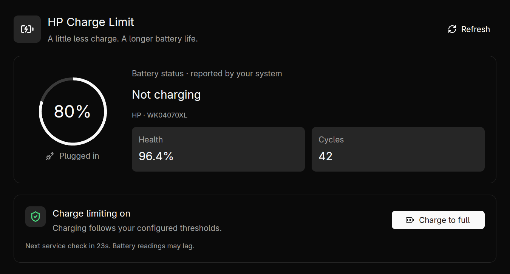
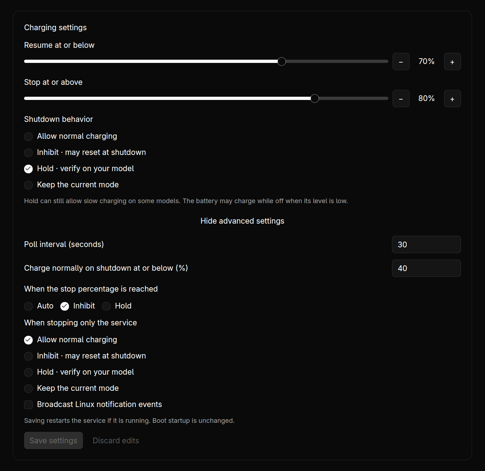

# hp-charge-limit-rs

Stop your HP laptop from charging past a limit you choose, for example 80%.
Keeping a lithium-ion battery below full while plugged in all day helps it last
longer. Works on Linux and Windows, on many Victus, OMEN and other HP laptops
(see [Tested models](#tested-models)).

<p align="center">
  
</p>

- **You pick the numbers:** stop at 80%, resume at 75%, or anything else.
- **It keeps limiting while the laptop is off** on boards that support it.
- **One click for a full charge** before a trip, then back to limiting.
- **Light:** the background service uses about 6 MiB of RAM. The optional tray
  icon uses about 6 MiB too, and the dashboard only runs when you open it.

## Is it safe for my laptop?

The worst it can do is stop your battery from charging, and that is undone with
one click or one command. It only uses the laptop firmware's own charge switch.
It never touches BIOS settings, never drains or disconnects the battery, and
installs no driver on Windows. If your firmware doesn't have this switch, the
call is simply refused and nothing changes.

It is still an unofficial tool with no warranty, and there is no model check,
so run the read-only check first (the setup steps below do this). Details:
[Safety details](docs/how-it-works.md#safety-details).

## Pick how to install

| You use | Easiest option |
|---|---|
| Windows, want a window and tray icon | [Desktop app for Windows](#windows-desktop) |
| Linux, want a window and tray icon | [Desktop app for Linux](#linux-desktop) |
| Arch Linux, terminal is fine | [AUR package](docs/linux.md#arch-linux-aur) |
| Other Linux, terminal is fine | [Prebuilt CLI](docs/linux.md#linux-manual-installation) |
| Windows, terminal is fine | [Windows CLI](docs/windows.md) |

The desktop app includes the command-line tool (CLI). If you start with the
CLI, you can add the desktop app later without uninstalling anything or
re-entering your limits. The app detects your existing service and leaves its
settings alone. If the service is stopped, click **Start existing service**.
If you only ran `daemon` in a terminal, stop it with Ctrl+C before setting up
the background service in the app. You can keep using the CLI the whole time,
including after removing the desktop app.

> **Windows desktop app:** it builds and passes CI, but it has not been tested
> on a real Windows laptop yet. The Windows CLI has been tested by users on
> many boards.

## Desktop app

Installing the app alone does **not** start charge limiting: install it, then
follow [Turn on charge limiting](#turn-on-charge-limiting).

### Windows desktop

1. Open [GitHub Releases](https://github.com/kralonur/hp-charge-limit-rs/releases)
   and expand **Assets** on a release that includes the desktop app. Download
   `hp-charge-limit-desktop-v<version>-x86_64-setup.exe`. Don't choose the
   CLI ZIP or **Source code**. If the setup file isn't listed, that release
   doesn't have a desktop installer.
2. Open **Downloads**, double-click the setup file, and follow the prompts.
   Do not use **Run as administrator**. The installer is unsigned, so Windows
   may show an unknown-publisher or SmartScreen warning. Only use a download
   from the official project page above.
3. Leave **Launch HP Charge Limit** checked on the final screen and click
   **Finish**. You can also open **HP Charge Limit** from the Start menu.
   No terminal or extra driver is needed. Setup installs the tray shortcut
   as well, but it doesn't start the tray or add it to login startup.

### Linux desktop

Linux has no click-through installer yet. The prebuilt desktop bundle is for
64-bit Intel/AMD PCs (`x86_64`) with systemd. It's built on Ubuntu 26.04 and
may not run on older distributions. If the app fails to open because a system
library is too old, use the [CLI packages](#pick-how-to-install) or
[build the desktop app locally](docs/desktop.md#desktop-dashboard-and-tray).

1. **Install the prerequisites.** Open Terminal and use the command for your
   distribution. Linux needs `acpi_call` (the battery-control kernel module)
   for your running kernel, `iasl` (included with ACPICA), and polkit with a
   desktop password prompt.

   On Arch with the standard `linux` kernel:

   ```sh
   sudo pacman -S acpica acpi_call polkit
   ```

   On Debian 13 or Ubuntu 24.04 with a distro-provided kernel:

   ```sh
   sudo apt update
   sudo apt install acpica-tools "linux-headers-$(uname -r)" acpi-call-dkms pkexec
   ```

   On Ubuntu, `acpi-call-dkms` is in the **Universe** software repository.
   For another distribution or kernel, check its documentation for the
   matching `acpi_call` package and polkit setup. If installation fails, fix
   that before continuing.
2. **Download the app.** Open
   [GitHub Releases](https://github.com/kralonur/hp-charge-limit-rs/releases)
   and expand **Assets** on the newest release that includes the desktop app.
   Download
   `hp-charge-limit-desktop-v<version>-x86_64-unknown-linux-gnu.tar.gz`.
   Don't choose the `musl` CLI download or **Source code**.
3. **Extract and install it.** In your file manager, extract the downloaded
   `.tar.gz`. Open the resulting folder that
   contains `install.sh`. Right-click an empty area and choose **Open in
   Terminal** (some file managers call it **Open Terminal Here**). Run:

   ```sh
   sh ./install.sh
   ```

   Don't add `sudo`: the app is installed for your user only. When the command
   finishes, open **HP Charge Limit** from your applications menu.

### Turn on charge limiting

1. Open **Compatibility and verification guide** in the dashboard to check
   [Tested models](#tested-models). If Linux shows **Load ACPI driver**, click
   it and approve the password prompt. The button
   loads the module you already installed; it can't download it for you.
2. Click **Run read-only diagnostics** and approve the prompt. If the check
   fails, don't continue. A pass means the app can read the firmware, not that
   it can stop charging. To check that, plug in below 100% while the laptop is
   charging. Under **Diagnostics & manual control**, select **Set Inhibit**,
   then **Start check** under **Timed charging check**. If the battery keeps
   gaining energy, leave the limiter off. Select **Set Auto** after the test
   to restore normal charging. Charging while shut down is a separate check;
   don't assume that it stops just because this test passes.
3. Set **Resume at or below** and **Stop at or above** (for example, 75% and
   80%). Check **I checked compatibility and agree to install and enable the
   service**, click **Install and enable service**, then approve the system
   prompt. The service starts now and on future boots.

<details>
<summary>Show charging and advanced settings</summary>

<p align="center">
  
</p>

</details>

If you already have the service, the dashboard uses it without replacing it.
Click **Start existing service** if it is stopped. Closing the app or tray
doesn't stop the background limiter.

**To remove it:** First choose **Service management → Remove service** if
shown. For a Linux service installed separately, use its uninstall steps:
[manual installation](docs/linux.md#linux-manual-installation) or [Arch Linux](docs/linux.md#arch-linux-aur).
Then remove the app: on Windows, uninstall **HP Charge Limit Desktop** from
**Settings → Apps**; on Linux, run `sh ./install.sh --uninstall` in the extracted
folder. Removing just the app does not stop or remove the service.

### Use the tray icon (optional)

The CLI-only download doesn't include a tray icon. If you install the desktop
app now or later, launch **HP Charge Limit Tray** to show the icon:

- **Windows:** Find **HP Charge Limit Tray** in Start. Look for the icon near
  the clock; it may be under the hidden-icons arrow (**^**).
- **Linux:** Find **HP Charge Limit Tray** in your applications menu. KDE
  Plasma supports it out of the box. On GNOME, enable an AppIndicator or
  StatusNotifierItem extension to see it.

Use the tray menu to **Open dashboard** or, when the limiter is running,
**Charge to full** / **Resume limiting**. To make the tray appear every time
*you sign in*, check **Start tray at login** in the tray menu or under
**Preferences & help** in the dashboard. To show it right now, launch the
tray shortcut. Closing the dashboard doesn't close the tray, and **Quit tray**
doesn't stop the background limiter.

## Tested models

Reports from users, with what each mode did. "Slow charge" means the
battery still gained energy in hold rather than charging being fully blocked.
Rates and test durations are listed where reported; readback alone does not
prove charge blocking.

| model | board | BIOS | OS | inhibit (running) | hold (off) |
|---|---|---|---|---|---|
| OmniBook 3 14-ha0xxx | 8E2D | F.06 | NixOS | works | works (blocks charging) |
| Victus 16-r1xxx | 8C99 | F.16 | Linux | works | works (blocks charging) |
| Victus 16-r0xxx | 8BC2 | F.30 | Arch Linux | works | off behavior unverified; hold adds +240 mWh in 5 min while running (about 2.88 W) |
| Victus 16-e0xxx | 88ED | F.27 | Windows 10 | works | works (blocks charging) |
| Victus 16-e0xxx | 88EB | F.21 | Windows 11 | works | +0 mWh in 5 min while running; historical off report: 78% → 76%, -724 mWh in 269 min (not a controlled shutdown test) ([#9](https://github.com/kralonur/hp-charge-limit-rs/issues/9)) |
| Victus 16-e1xxx | 8A22 | F.28 | Windows | works | slow charge: about 3.5 W, 80% → 87% in 50 min off |
| Victus 15-fb0xxx | 8A3D | F.26 | Windows 11 | works | slow charge: about 1.7 W, 80% → 81% in 30 min off, 80% → 100% overnight |
| Victus 15-fb0xxx (15-fb0051ax) | 8A3C | F.26 | Windows | works | slow charge: +185 mWh in 5 min while running (about 2.22 W); off slow charge reported, `--off-mode inhibit` reportedly blocks charging until AC unplug/replug; replacement battery with calibration issues ([#10](https://github.com/kralonur/hp-charge-limit-rs/issues/10)) |
| Victus 15-fa1xxx | 8C2D | F.18 | Windows 11 | works | slow charge: about 2.34 W while running; no charge overnight in hibernate reported (shutdown test not reported) |
| Victus 15-fa1xxx | 8BB1 | F.23 | Linux (direct ACPI test) | works | not tested |
| Victus 15-fa0xxx | 8A4F | F.34 | Windows 11 | works | slow charge: about 2.4 W while running (off test not reported) |
| Victus 15-fa2xxx | 8DCD | F.07 | Windows 11 | works | not tested |
| Victus 15-fb2xxx (15-fb2111AX) | 8C2F | F.05 | Windows | works | not tested |
| Victus 15-fb2xxx (15-fb2082wm) | 8C2F | F.10 | Windows | works | inhibit kept (`--off-mode keep`) blocks charging: +0 mWh in 30 min off, 53% → 53%; hold while running let it rise 50% → 53% ([#14](https://github.com/kralonur/hp-charge-limit-rs/issues/14)) |
| Victus 15-fb3xxx | (not reported) | (not reported) | Windows | works | slow charge (rate not reported) |
| Victus 15-fb3xxx | 8DD0 | F.15 | Pop!_OS 24.04 | works | not tested |
| Victus 15-fb3xxx | 8DD0 | F.15 | Windows 11 | works | use `--off-mode inhibit` |
| Victus 15-fb3xxx | 8E5F | F.15 | Windows 11 | works | slow charge: +709 mWh in 18 min off (about 2.36 W), 80% → 81%; +185 mWh in 5 min while running (about 2.22 W) ([#7](https://github.com/kralonur/hp-charge-limit-rs/issues/7)) |
| OMEN 16-xd0xxx | 8BCD | F.32 | Windows 11 | works | slow charge; use `--off-mode inhibit` (blocks charging) ([#8](https://github.com/kralonur/hp-charge-limit-rs/issues/8)) |
| HP Laptop 15s-du4xxx | 89A1 | F.69 | Windows 11 | works | +230 mWh in 4 min off; longer test pending; hold adds +500 mWh in 10 min while running ([#3](https://github.com/kralonur/hp-charge-limit-rs/issues/3)) |
| HP Laptop 15s-du4xxx | 89A1 | F.69 | Linux | works | off test not reported; hold adds +230 mWh in 5 min while running (about 2.76 W) |

On board 8A3C, AC unplug/replug while off reportedly resets charging to auto
with `--off-mode hold`, `inhibit`, or `keep`. The daemon reapplies the limit
when Windows starts; it cannot enforce a limit while the machine is off
([#10](https://github.com/kralonur/hp-charge-limit-rs/issues/10)).

Your model is missing or behaves differently? Please
[open an issue](https://github.com/kralonur/hp-charge-limit-rs/issues)
with the output of `diagnose` and the tests in the
[test order](docs/windows.md).

## More documentation

- [Using the CLI](docs/usage.md): status, diagnostics, full-charge bypass, daemon options
- [Linux CLI](docs/linux.md): manual install, AUR, desktop notifications, shell completion
- [Windows CLI](docs/windows.md): test order, service, what to report
- [Desktop dashboard and tray](docs/desktop.md): details, building, RAM usage
- [How it works](docs/how-it-works.md): charging policy, safety details, firmware interface, limitations
- [Development](docs/development.md): publishing releases, code layout

## License

This project's original code is dual-licensed under either
[MIT](LICENSE-MIT) or [Apache-2.0](LICENSE-APACHE), at your option
(`MIT OR Apache-2.0`).
