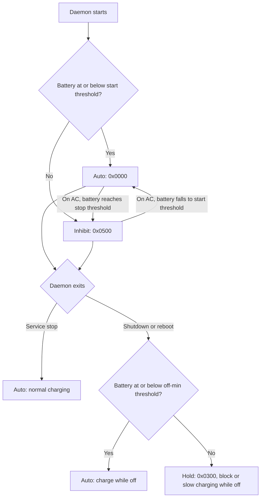

# How it works

## Charging policy

Default policy with bypass disabled (mode changes depend on successful firmware writes):

Charging resumes at the start threshold (default: 40%) and stops at the
stop threshold (default: 50%). At shutdown, the off-min threshold
(default: 40%) selects normal charging instead of hold when the battery
is low. All three thresholds are configurable.

Between thresholds, the current state is kept. Polls on battery leave the
firmware mode unchanged. Shutdown detection and off-state behavior have
the limitations described below.

## Safety details

The worst this tool can do is stop your battery from charging. Use
`bypass on` to allow normal charging while the service is running, or
`set auto` if no daemon is running. It is still an unofficial tool,
provided without warranty (see the licenses). These are the reasons the
risk is small:

- **It only switches charging on and off.** The three modes are the
  firmware's own charge switches: four flags in the embedded controller's
  (EC) memory, WACL, SBIS, SBTC and WPBS. `auto` clears all four, which is
  the stock state. Nothing touches BIOS settings, NVRAM or flash, and on
  Windows no driver is installed.
- **It never charges more, and never drains or disconnects the battery.**
  A limiter only ever charges less. The battery pack's own protection
  electronics are not touched; inhibit and hold are states the EC firmware
  itself implements. Force-discharge (0x0200) and battery ship mode
  (0x0600/0x0700, which disconnects the battery) cannot be expressed in the
  code: no command or option sends them.
- **Firmware without this method refuses the call.** `diagnose` only reads.
  On Linux, `acpi_call` answers `AE_NOT_FOUND` when the method is missing;
  on Windows, HP's BIOS answers return code 4 for a command type it does not
  have. Nothing changes in either case. The remaining risk is firmware that
  has the method but means something else by it. That is why you should run
  [`diagnose`](usage.md#setup-diagnostics) first (on Windows, follow the
  [test order](windows.md)), and why reports with
  your model matter.
- **Undo is one command, and stopping does it for you.** With the service
  running, [`bypass on`](usage.md#temporary-full-charge-bypass) pauses its limits and
  allows normal charging on the next AC-powered poll. `set auto` is only a
  one-time firmware change: a running daemon can override it. Stopping or
  uninstalling the service sets auto by default. Inhibit usually ends by
  itself at shutdown (on board 8BCD it stayed, see
  [#8](https://github.com/kralonur/hp-charge-limit-rs/issues/8)). Hold
  outlasts a shutdown, until `set auto` or the service's next start.
  In hold the LED and battery status may say charging; that is only
  cosmetic. On some boards hold still lets a slow charge through (about
  2 W), so it limits less, but it never charges faster than normal.

Uninstalling leaves the laptop as it was before: see the uninstall steps
for [Linux](linux.md#linux-manual-installation), [Arch](linux.md#arch-linux-aur) and
[Windows](windows.md) (*Remove everything*).

## Firmware interface

The tool uses the firmware's ACPI WMI method
`\_SB.WMID.SBCC`: through `acpi_call` on Linux, and through HP's BIOS WMI
interface on Windows (see [Tested models](../README.md#tested-models)). Linux prefers
`GBCO`/`SBCO` when declared, otherwise using the `GBCC`/`SBCC`
interface. Before any charge-control call, ACPICA's `iasl` inspects the
DSDT and SSDTs (including dynamically loaded tables) offline to discover
method signatures. Supported pairs are `GBCO(0)`/`SBCO(1)` (packed integer),
`GBCO(0)`/`SBCO(4)` (four byte arguments), and `GBCC(0)`/`SBCC(1)` (buffer
or integer). For SBCC, discovery also inspects the method body: a DWORD
extracted from `Arg0` at offset `0x10` selects the buffer format; direct
`Arg0 & 0xFF` / `Arg0 & 0xFF00` checks select the integer format.
Unknown, incomplete, or ambiguous signatures, argument uses, and tool failures are rejected;
there is no fallback to guessed writes. Argument counts do not prove that
unknown firmware implements the same semantics.

I tried this on an HP Victus 16-r1000 laptop. It may work on your PC too,
but compatibility is not guaranteed: your firmware must expose the same
methods and calling convention. There is no model or board check, so verify
compatibility before using it; unsupported firmware calls can be unsafe
(see [Safety details](#safety-details)).

| mode | SBCC | while running | survives shutdown |
|---|---|---|---|
| `auto` | 0x0000 | charges | — |
| `inhibit` | 0x0500 (SBIS) | no charge, white LED, "Not charging" | usually no, EC clears it; on board 8BCD it kept blocking ([#8](https://github.com/kralonur/hp-charge-limit-rs/issues/8)) |
| `hold` | 0x0300 (SBTC) | no charge or slow charge, depending on the board; LED/status still say charging | yes, but on some boards it only slows charging |

Only these three are ever written (never discharge 0x0200 or ship mode 0x0600/0x0700).
Inhibit (the limit while running) works on the confirmed models, but not
every reported board/OS combination; hold (the limit while off) also depends
on the board: see [Tested models](../README.md#tested-models).

**On some boards hold does not block charging, it only slows it** (about
2–3 W). If yours is one of them, try `--off-mode inhibit`: on at least one
board (8BCD) inhibit kept blocking charging while off, 80% → 79% over
883 min off ([#8](https://github.com/kralonur/hp-charge-limit-rs/issues/8)).
Signature discovery uses a private temporary directory, never loads generated
AML, and allows up to 60 seconds for `iasl` subprocesses. Successful discovery
is cached for the lifetime of the process, not across restarts or BIOS updates;
failed discovery can be retried. Restart the daemon if ACPI tables change after
discovery. Other firmware or ACPICA versions may fail disassembly/compilation;
such failures block charge-control calls rather than guessing an interface.
Power supplies are discovered under `/sys/class/power_supply` by type,
ignoring peripherals marked `scope=Device`. One present battery is
selected: `BAT1` if available, otherwise the first battery in alphabetical
name order. Multiple batteries are not aggregated. Any online system-level
mains, USB, or wireless supply counts as external power. Discovery is refreshed
on each read to handle hotplug. Discovery does not establish firmware compatibility.

## Why this repo?

I know other repos already expose `0x0500` (inhibit), but none of the ones
I tried stopped my laptop from charging while it was off. They worked
while running, but after shutdown it kept charging.

This repo uses inhibit while running and, by default, switches to
`0x0300` (hold) at shutdown to keep charging blocked while off. It also
has a low-battery override so the laptop can charge while off when needed.
On my laptop this has worked in daily use for weeks: hold blocks charging
through every shutdown, overnight included. It does not block charging on
every board, though: on some it only slows charging to about 2 W, so a long
shutdown still ends near full. The limit while running works on
confirmed models; other reports are still under investigation.

## Verification and limitations

There is currently no automated test suite. `cargo check --locked` checks
compilation; it does not verify firmware behavior. The Windows build is
checked with `cargo check --target x86_64-pc-windows-gnu` and `clippy`, and
smoke-tested on a CI runner without HP firmware; on laptops it has only the
user reports in [Tested models](../README.md#tested-models).

On my laptop (board 8C99), inhibit reads back as GBCC mode 4, and weeks of
daily use show shutdown detection and hold working: every shutdown in the
journal logs `shutdown: cap=..% -> hold`, and the next boot reports
`off N min in hold` with no charge gained, over offs of up to 14 hours.
Testers on other boards found hold only slowing charging (about 2 W), so
this is not a guarantee for other machines or firmware versions; see
[Tested models](../README.md#tested-models). On board 8BCD, inhibit instead kept
blocking charging while off
([#8](https://github.com/kralonur/hp-charge-limit-rs/issues/8)). To check your own laptop, look in
the journal for those two lines.

Still unverified:

- Holding through AC unplug/replug while off.

The off-state record and last report live under `/var/lib/hp-charge-limit-rs/`.
In hold mode, LED and battery status may still say charging; use
`status --watch 300` to observe energy changes instead (a slow charge of
about 2 W needs a few minutes to show).
